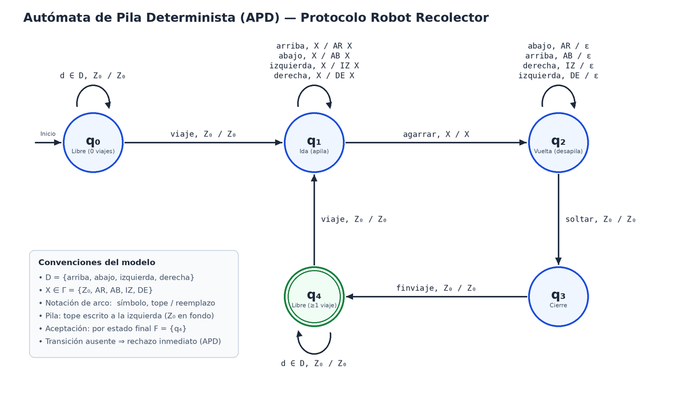

# Trabajo Práctico de Promoción — Robot Recolector
**Asignatura:** Fundamentos Teóricos de la Informática  
**Grupo:** 03 · *Bloque de pedido*  
**Integrantes:** *(Completar nombres, apellidos y legajos)*  
**Fecha:** *(Completar)*

---

## 1. Instancia asignada (Grupo 03 · Bloque de pedido)

* **Grilla:** 6 filas × 6 columnas. La coordenada `(f, c)` indica fila `f` (1 arriba) y columna `c` (1 izquierda).
* **Robot inicial y final (`R`):** `(6, 1)` (pinza vacía).
* **Cajas iniciales (`C`):** `(1, 1)`, `(1, 5)`, `(2, 3)`, `(3, 6)`.
* **Obstáculos (`X`):** `(2, 2)`, `(2, 4)`, `(3, 4)`, `(5, 3)`.
* **Destinos finales (`T`):** `(5, 4)`, `(5, 5)`, `(6, 4)`, `(6, 5)`.

### Grilla inicial

| f \ c | 1 | 2 | 3 | 4 | 5 | 6 |
| :---: | :---: | :---: | :---: | :---: | :---: | :---: |
| **1** | **C** | . | . | . | **C** | . |
| **2** | . | **X** | **C** | **X** | . | . |
| **3** | . | . | . | **X** | . | **C** |
| **4** | . | . | . | . | . | . |
| **5** | . | . | **X** | T | T | . |
| **6** | **R** | . | . | T | T | . |

### Grilla final (meta alcanzada)

| f \ c | 1 | 2 | 3 | 4 | 5 | 6 |
| :---: | :---: | :---: | :---: | :---: | :---: | :---: |
| **1** | . | . | . | . | . | . |
| **2** | . | **X** | . | **X** | . | . |
| **3** | . | . | . | **X** | . | . |
| **4** | . | . | . | . | . | . |
| **5** | . | . | **X** | **C/T** | **C/T** | . |
| **6** | **R** | . | . | **C/T** | **C/T** | . |

---

## 2. Estrategia y programa completo

### Criterio de diseño de la estrategia
Como el protocolo exige iniciar cada bloque `viaje` parado en la **celda destino** donde se depositará la caja, recorrer un camino de ida hasta una caja, ejecutar `agarrar`, regresar por el **camino exactamente inverso** y ejecutar `soltar` + `finviaje`, se definió la siguiente estrategia:

1. **Recorrido compacto de los 4 destinos (`T`)**: desde `R = (6, 1)` se avanza en línea recta hacia `(6, 4)` y luego se recorre el bloque 2×2 de destinos en sentido antihorario paso a paso: `(6, 4) → (6, 5) → (5, 5) → (5, 4)`. Así, entre un viaje y el siguiente el robot solo realiza **1 movimiento libre**.
2. **Asignación caja → destino por cercanía y corredores libres**: se emparejó cada destino con una caja cuyo camino libre de obstáculos sea directo (todos los tramos alcanzan la distancia Manhattan mínima):
   * **Viaje 1:** Destino `(6, 4)` ← Caja `(2, 3)` — 5 pasos de ida (`arriba arriba izquierda arriba arriba`), evitando `(5, 3)` y `(3, 4)` por columna 4 hasta fila 4 y subiendo por columna 3.
   * **Viaje 2:** Destino `(6, 5)` ← Caja `(3, 6)` — 4 pasos de ida (`arriba arriba arriba derecha`), subiendo por la columna 5 libre hasta fila 3 y girando a la derecha.
   * **Viaje 3:** Destino `(5, 5)` ← Caja `(1, 5)` — 4 pasos de ida (`arriba arriba arriba arriba`), en línea recta por la columna 5.
   * **Viaje 4:** Destino `(5, 4)` ← Caja `(1, 1)` — 7 pasos de ida (`arriba izquierda izquierda izquierda arriba arriba arriba`), utilizando la fila 4 (totalmente libre) hasta la columna 1 y subiendo hasta `(1, 1)`.
3. **Regreso final a `(6, 1)`**: desde `(5, 4)`, el robot se desplaza con pinza vacía mediante `abajo izquierda izquierda izquierda` (pasando por `(6, 4)`, celda con caja ya depositada, permitido explícitamente por las reglas de circulación del mundo) hasta finalizar en `(6, 1)`.

Todos los viajes tienen 4 o más movimientos de ida (5, 4, 4 y 7), cumpliendo con holgura la exigencia del enunciado.

### Resumen de viajes y métricas de la solución

| Tramo / Viaje | Desde → Hasta | Pasos ida | Pasos vuelta | Mov. sin carga | Mov. con carga | Altura máx. pila (sin Z₀) |
| :--- | :---: | :---: | :---: | :---: | :---: | :---: |
| Desplazamiento inicial | `(6,1) → (6,4)` | — | — | 3 | 0 | 0 |
| **Viaje 1** | `T=(6,4) ↔ C=(2,3)` | 5 | 5 | 5 | 5 | 5 |
| Tramo entre viajes | `(6,4) → (6,5)` | — | — | 1 | 0 | 0 |
| **Viaje 2** | `T=(6,5) ↔ C=(3,6)` | 4 | 4 | 4 | 4 | 4 |
| Tramo entre viajes | `(6,5) → (5,5)` | — | — | 1 | 0 | 0 |
| **Viaje 3** | `T=(5,5) ↔ C=(1,5)` | 4 | 4 | 4 | 4 | 4 |
| Tramo entre viajes | `(5,5) → (5,4)` | — | — | 1 | 0 | 0 |
| **Viaje 4** | `T=(5,4) ↔ C=(1,1)` | 7 | 7 | 7 | 7 | **7** |
| Regreso final | `(5,4) → (6,1)` | — | — | 4 | 0 | 0 |
| **TOTAL** | **66 tokens** | **20** | **20** | **30** | **20** | **7** |

### Programa completo (66 tokens)

```text
derecha derecha derecha
viaje
  arriba arriba izquierda arriba arriba
  agarrar
  abajo abajo derecha abajo abajo
  soltar
finviaje
derecha
viaje
  arriba arriba arriba derecha
  agarrar
  izquierda abajo abajo abajo
  soltar
finviaje
arriba
viaje
  arriba arriba arriba arriba
  agarrar
  abajo abajo abajo abajo
  soltar
finviaje
izquierda
viaje
  arriba izquierda izquierda izquierda arriba arriba arriba
  agarrar
  abajo abajo abajo derecha derecha derecha abajo
  soltar
finviaje
abajo izquierda izquierda izquierda
```

---

## 3. Diseño de la Gramática Libre de Contexto (GLC)

### Decisión de diseño: entrada vacía vs. al menos un viaje
Se decide que el lenguaje **exige al menos un viaje** y, por lo tanto, **no acepta la entrada vacía (ε)** ni secuencias formadas únicamente por desplazamientos libres sin recolecciones.  
**Justificación:** el protocolo describe programas de un *robot recolector*; un programa sin ningún bloque `viaje ... finviaje` no efectúa recolección alguna. Esta decisión se refleja de forma idéntica en la GLC, en el AP y en la implementación del reconocedor.

### Definición formal
Sea `G = (V_N, V_T, P, S)`:

* **No terminales (`V_N`):** `{ S, R, V, C, D }`
* **Terminales (`V_T`):** `{ arriba, abajo, izquierda, derecha, agarrar, soltar, viaje, finviaje }`
* **Símbolo inicial:** `S`
* **Producciones (`P`):**

```text
S → D S | V R
R → D R | V R | ε
V → viaje C soltar finviaje
C → arriba C abajo
  | abajo C arriba
  | izquierda C derecha
  | derecha C izquierda
  | agarrar
D → arriba | abajo | izquierda | derecha
```

### Lenguaje generado y papel de la recursión
El lenguaje generado por `G` es:

```text
L(G) = { u₀ v₁ u₁ v₂ ... vₖ uₖ | k ≥ 1, uᵢ ∈ D*, vⱼ = viaje wⱼ agarrar inv(wⱼ)ᴿ soltar finviaje, wⱼ ∈ D* }
```

donde `D = {arriba, abajo, izquierda, derecha}` e `inv(w)ᴿ` denota la secuencia obtenida al invertir el orden de los movimientos de `w` y reemplazar cada dirección por su opuesta (`arriba ↔ abajo`, `izquierda ↔ derecha`).

* **Recursión lineal a derecha (`S`, `R`):** permite anteponer, intercalar y posponer cualquier número de movimientos con pinza vacía (`D*`) y encadenar secuencialmente `k ≥ 1` viajes sin anidarlos. Como `S` no deriva `ε`, se garantiza la existencia de al menos un bloque `V`.
* **Recursión central (`C`):** cada aplicación recursiva agrega simultáneamente un movimiento de ida a la izquierda y su movimiento inverso a la derecha, tomando `agarrar` como caso base central. Esto modela recorridos de ida y vuelta de longitud arbitraria `n ≥ 0` (incluyendo `viaje agarrar soltar finviaje` cuando `n = 0`) sin depender de la grilla particular.

### Derivación completa de un viaje de la solución (Viaje 2 — 4 movimientos de ida)
Se presenta la derivación más a la izquierda desde el símbolo inicial `S` para el **Viaje 2**:
`viaje arriba arriba arriba derecha agarrar izquierda abajo abajo abajo soltar finviaje`

1. `S`
2. `⇒ V R`  *(por `S → V R`)*
3. `⇒ viaje C soltar finviaje R`  *(por `V → viaje C soltar finviaje`)*
4. `⇒ viaje arriba C abajo soltar finviaje R`  *(por `C → arriba C abajo`)*
5. `⇒ viaje arriba arriba C abajo abajo soltar finviaje R`  *(por `C → arriba C abajo`)*
6. `⇒ viaje arriba arriba arriba C abajo abajo abajo soltar finviaje R`  *(por `C → arriba C abajo`)*
7. `⇒ viaje arriba arriba arriba derecha C izquierda abajo abajo abajo soltar finviaje R`  *(por `C → derecha C izquierda`)*
8. `⇒ viaje arriba arriba arriba derecha agarrar izquierda abajo abajo abajo soltar finviaje R`  *(por `C → agarrar`)*
9. `⇒ viaje arriba arriba arriba derecha agarrar izquierda abajo abajo abajo soltar finviaje`  *(por `R → ε`)*

**Integración en el programa completo:**  
El programa completo del Grupo 03 se deriva desde `S` expandiendo la secuencia de desplazamientos libres y los cuatro viajes secuenciales:

`S ⇒* D₁ D₂ D₃ V₁ D₄ V₂ D₅ V₃ D₆ V₄ D₇ D₈ D₉ D₁₀`

donde:
* `D₁ D₂ D₃` deriva `derecha derecha derecha` mediante `S → D S` (3 veces), seguido de `S → V R` que introduce `V₁` (Viaje 1).
* A partir del no terminal `R` restante, se aplica `R → D R` (generando `D₄ = derecha`) y luego `R → V R`, que introduce `V₂` (**Viaje 2**, cuya derivación interna es idéntica a los pasos 3–8 anteriores).
* El resto de `R` continúa expandiendo `D₅ = arriba`, `V₃` (Viaje 3), `D₆ = izquierda`, `V₄` (Viaje 4), el regreso `D₇ D₈ D₉ D₁₀ = abajo izquierda izquierda izquierda`, y concluye con `R → ε`.

---

## 4. Diseño del Autómata de Pila (AP)

### Definición formal (7-tupla)
Sea `M = (Q, Σ, Γ, δ, q₀, Z₀, F)`:

* **Conjunto de estados (`Q`):** `{ q₀, q₁, q₂, q₃, q₄ }`
  * `q₀`: fuera de viaje, aún no se completó ningún viaje (inicial, no final).
  * `q₁`: dentro de un viaje, **fase de ida** (apila movimientos).
  * `q₂`: dentro de un viaje, **fase de vuelta** (desapila verificando el movimiento inverso).
  * `q₃`: `soltar` ejecutado con pila en `Z₀`; espera obligatoriamente `finviaje`.
  * `q₄`: fuera de viaje, al menos un viaje completado (**estado final / de aceptación**).
* **Alfabeto de entrada (`Σ`):** `{ arriba, abajo, izquierda, derecha, agarrar, soltar, viaje, finviaje }`
* **Alfabeto de pila (`Γ`):** `{ Z₀, AR, AB, IZ, DE }`
* **Estado inicial:** `q₀`
* **Marcador inicial de fondo de pila:** `Z₀`
* **Conjunto de estados finales (`F`):** `{ q₄ }`

### Convención de escritura de la pila y forma de aceptación
* **Convención de pila:** se escribe con el **tope a la izquierda** y el fondo `Z₀` a la derecha (ejemplo: `DE AR AR AR Z₀` significa `DE` en el tope).
  * Reemplazar `X` por `AR X` equivale a **apilar** `AR` sobre `X`.
  * Reemplazar `X` por `X` mantiene la pila **sin cambios**.
  * Reemplazar `X` por `ε` equivale a **desapilar** `X`.
* **Forma de aceptación:** **aceptación por estado final** (`q₄ ∈ F`) al consumir completamente la entrada. Por construcción del autómata, siempre que se alcanza `q₄` la pila contiene únicamente `Z₀`.
* **Determinismo:** `M` es un **AP determinista (APD)** sin transiciones `ε`: para cada terna `(q, a, X)` existe a lo sumo una transición definida. Toda terna ausente en la tabla produce rechazo inmediato.

### Tabla de transiciones `δ(q, a, X)`
*(Donde `d ∈ D = {arriba, abajo, izquierda, derecha}` y `X ∈ Γ`.)*

| Estado actual | Símbolo leído (`a`) | Tope de pila (`X`) | Estado siguiente | Reemplazo en pila | Descripción |
| :---: | :---: | :---: | :---: | :---: | :--- |
| `q₀` | `d ∈ D` | `Z₀` | `q₀` | `Z₀` | Desplazamiento libre antes del 1.er viaje |
| `q₀` | `viaje` | `Z₀` | `q₁` | `Z₀` | Apertura del 1.er viaje |
| `q₁` | `arriba` | `X ∈ Γ` | `q₁` | `AR X` | Apila `arriba` en ida |
| `q₁` | `abajo` | `X ∈ Γ` | `q₁` | `AB X` | Apila `abajo` en ida |
| `q₁` | `izquierda` | `X ∈ Γ` | `q₁` | `IZ X` | Apila `izquierda` en ida |
| `q₁` | `derecha` | `X ∈ Γ` | `q₁` | `DE X` | Apila `derecha` en ida |
| `q₁` | `agarrar` | `X ∈ Γ` | `q₂` | `X` | Toma caja y pasa a fase de vuelta |
| `q₂` | `abajo` | `AR` | `q₂` | `ε` | Desapila `AR` al volver con `abajo` |
| `q₂` | `arriba` | `AB` | `q₂` | `ε` | Desapila `AB` al volver con `arriba` |
| `q₂` | `derecha` | `IZ` | `q₂` | `ε` | Desapila `IZ` al volver con `derecha` |
| `q₂` | `izquierda` | `DE` | `q₂` | `ε` | Desapila `DE` al volver con `izquierda` |
| `q₂` | `soltar` | `Z₀` | `q₃` | `Z₀` | Permite `soltar` solo con pila vacía de viaje |
| `q₃` | `finviaje` | `Z₀` | `q₄` | `Z₀` | Cierra el viaje y habilita aceptación |
| `q₄` | `d ∈ D` | `Z₀` | `q₄` | `Z₀` | Desplazamiento libre tras ≥ 1 viaje |
| `q₄` | `viaje` | `Z₀` | `q₁` | `Z₀` | Apertura de un nuevo viaje |

### Diagrama de estados



### Traza del AP para el Viaje 2 (4 movimientos de ida)
Contexto en el programa completo: inmediatamente antes del token 19 (luego de completar el Viaje 1 y moverse con `derecha` a `(6, 5)`), el autómata se encuentra en estado `q₄` con pila `Z₀`, posición `(6, 5)` y pinza `vacía`.

| Índice | Token leído | Estado ant. | Tope ant. | Estado sig. | Pila resultante (tope a izq.) | Posición | Carga |
| :---: | :---: | :---: | :---: | :---: | :--- | :---: | :---: |
| — | *(inicio Viaje 2)* | — | — | `q₄` | `Z₀` | `(6, 5)` | Vacía |
| 19 | `viaje` | `q₄` | `Z₀` | `q₁` | `Z₀` | `(6, 5)` | Vacía |
| 20 | `arriba` | `q₁` | `Z₀` | `q₁` | `AR Z₀` | `(5, 5)` | Vacía |
| 21 | `arriba` | `q₁` | `AR` | `q₁` | `AR AR Z₀` | `(4, 5)` | Vacía |
| 22 | `arriba` | `q₁` | `AR` | `q₁` | `AR AR AR Z₀` | `(3, 5)` | Vacía |
| 23 | `derecha` | `q₁` | `AR` | `q₁` | `DE AR AR AR Z₀` | `(3, 6)` | Vacía |
| 24 | `agarrar` | `q₁` | `DE` | `q₂` | `DE AR AR AR Z₀` | `(3, 6)` | Con caja |
| 25 | `izquierda` | `q₂` | `DE` | `q₂` | `AR AR AR Z₀` | `(3, 5)` | Con caja |
| 26 | `abajo` | `q₂` | `AR` | `q₂` | `AR AR Z₀` | `(4, 5)` | Con caja |
| 27 | `abajo` | `q₂` | `AR` | `q₂` | `AR Z₀` | `(5, 5)` | Con caja |
| 28 | `abajo` | `q₂` | `AR` | `q₂` | `Z₀` | `(6, 5)` | Con caja |
| 29 | `soltar` | `q₂` | `Z₀` | `q₃` | `Z₀` | `(6, 5)` | Vacía |
| 30 | `finviaje` | `q₃` | `Z₀` | `q₄` | `Z₀` | `(6, 5)` | Vacía |

### Justificación de equivalencia: `L(M) = L(G)`
1. **Inclusión `L(G) ⊆ L(M)`:**
   * Toda cadena de `L(G)` comienza con `u₀ ∈ D*`, consumida por el lazo en `q₀` dejando la pila en `Z₀`.
   * Cada subcadena derivada de `V` tiene la forma `viaje w agarrar inv(w)ᴿ soltar finviaje`. Desde `(q₀, Z₀)` o `(q₄, Z₀)`, `viaje` lleva a `(q₁, Z₀)`. Por inducción sobre `|w|`, leer `w` apila los símbolos de sus movimientos en orden LIFO (el último movimiento de `w` queda en el tope). Luego `agarrar` pasa a `q₂` sin alterar la pila. Leer `inv(w)ᴿ` desapila exactamente símbolo por símbolo hasta exponer `Z₀`; entonces `soltar` transita a `(q₃, Z₀)` y `finviaje` a `(q₄, Z₀)`.
   * Como `G` deriva al menos un `V`, `M` alcanza `q₄` al menos una vez; los desplazamientos `uᵢ ∈ D*` y viajes posteriores mantienen o retornan a `(q₄, Z₀)`, aceptando al final de la entrada.
2. **Inclusión `L(M) ⊆ L(G)`:**
   * Para ser aceptada por `M`, una cadena debe finalizar en `q₄ ∈ F`. La única trayectoria desde `q₀` hasta `q₄` exige pasar al menos una vez por `q₀ → q₁ → q₂ → q₃ → q₄`.
   * En `q₀` solo se admiten símbolos de `D*` antes del primer `viaje`.
   * Dentro del ciclo `q₁ → q₂ → q₃ → q₄`, no existe transición para `viaje` (no hay anidamiento), `agarrar` solo ocurre una vez (al pasar de `q₁` a `q₂`), y la única forma de habilitar `soltar` en `q₂` es que el tope vuelva a ser `Z₀`, lo cual únicamente ocurre si la secuencia leída en `q₂` es exactamente `inv(w)ᴿ`, donde `w` es la secuencia leída en `q₁`. Finalmente `q₃` obliga a leer `finviaje`. Por lo tanto, cada paso por la submáquina corresponde exactamente a una cadena de `L(V)`.
   * Una vez en `q₄`, solo se admiten símbolos de `D` o nuevos bloques `L(V)`, coincidiendo exactamente con `L(R)`.
   * En consecuencia, toda cadena aceptada por `M` pertenece a `L(G)`.

---

## 5. Implementación

### Lenguaje y arquitectura modular
El sistema se implementó en **JavaScript (Node.js ≥ 18, ES Modules)** sin dependencias externas, organizado en módulos con responsabilidades estrictamente separadas:

* **`src/lexer.js` (Analizador léxico):** lee el archivo fuente ignorando espacios y saltos de línea, valida que cada lexema pertenezca al conjunto de las 8 palabras reservadas (`arriba`, `abajo`, `izquierda`, `derecha`, `agarrar`, `soltar`, `viaje`, `finviaje`) y, ante cualquier token desconocido, devuelve `ERROR_LEXICO` indicando índice de token, línea y columna del primer error.
* **`src/pda.js` (Reconocedor basado en el APD):** implementa directamente la función de transición `δ(estado, simbolo, tope)` definida en la Sección 4 utilizando una **pila explícita** (arreglo inicializado en `["Z0"]`, formateado con el tope a la izquierda). No utiliza atajos de conteo de órdenes opuestas. Registra cada transición, calcula la altura máxima de pila sin contar `Z₀` y exige finalizar en el estado de aceptación `q₄` (rechazando entradas vacías o sin viajes).
* **`src/simulator.js` (Simulador del mundo 6×6):** modela posición del robot, obstáculos, cajas (registrando su origen), destinos y estado de la pinza. Controla límites de la grilla, colisión con obstáculos, validez de `agarrar`/`soltar` (permitiendo circular sobre celdas con cajas según las reglas), contabiliza movimientos con y sin carga, renderiza grillas inicial y final, y verifica la meta.
* **`src/runner.js` (Orquestador en 3 fases y exportador de registros):** separa el resultado en cinco categorías excluyentes (`ERROR_LEXICO`, `RECHAZO_AP`, `ERROR_FISICO`, `OBJETIVO_NO_ALCANZADO`, `MISION_RESUELTA`) y genera el registro por token (`indice`, `orden`, `estado_ap`, `pila`, `posicion`, `carga`) en formato **CSV** y **TXT**.
* **`src/main.js` y `src/run_tests.js`:** interfaz CLI parametrizable (admite cualquier archivo de programa y cualquier instancia JSON sin modificar el reconocedor) y ejecutor automático de la batería de 11 pruebas.
* **`instancias/grupo03.json`:** especificación externa de la grilla del Grupo 03.

### Decisión de validación sintáctica previa a la simulación
El orquestador valida primero el programa completo con el **analizador léxico** y luego con el **Autómata de Pila**; recién cuando el AP acepta la secuencia se ejecuta la simulación física y se emite el registro combinado por token (`registros/solucion_grupo03.csv` y `registros/solucion_grupo03.txt`). Esta separación respeta estrictamente el principio del TP (*el AP controla el protocolo; el simulador controla el mundo y la meta*) y garantiza que un error sintáctico nunca quede enmascarado por un error físico anterior. Para las entradas rechazadas por el AP, el informe en texto incluye igualmente la traza del AP hasta el token de rechazo.

### Instrucciones para reproducir la ejecución
Desde la carpeta `ROBOT/` con Node.js instalado:

```bash
# 1. Ejecutar la solución completa del Grupo 03 y generar los registros CSV y TXT
npm run solucion

# 2. Ejecutar la batería completa de 11 pruebas (8 mínimas + 3 casos de borde)
npm test

# 3. Evaluar cualquier programa o instancia alternativa sin editar el reconocedor
node src/main.js ruta/al/programa.txt --instancia instancias/grupo03.json --csv salida.csv
```

### Archivos entregados
* **Informe PDF** (exportado desde este documento).
* **Código fuente:** `package.json`, `README.md`, `instancias/grupo03.json`, `src/lexer.js`, `src/pda.js`, `src/simulator.js`, `src/runner.js`, `src/main.js`, `src/run_tests.js`.
* **Programas de prueba:** `pruebas/01_solucion_grupo03.txt` a `pruebas/11_borde_salida_grilla.txt`.
* **Registros de la solución completa:** `registros/solucion_grupo03.csv` y `registros/solucion_grupo03.txt` (66 tokens, 30 movimientos sin carga, 20 con carga, altura máxima de pila = 7).

---

## 6. Pruebas mínimas y casos de borde

Todas las pruebas se ejecutaron con `npm test` sobre la instancia del Grupo 03 (`instancias/grupo03.json`). En las pruebas físicas (06, 07 y 11) se utilizaron programas **sintácticamente completos y aceptados por el AP** para aislar el error físico. Resultado global: **11/11 pruebas superadas**.

| # | Prueba y archivo | Entrada (resumen) | Resultado esperado | Resultado obtenido | Diagnóstico real del sistema |
| :-: | :--- | :--- | :---: | :---: | :--- |
| **01** | Solución completa Grupo 03 (`01_solucion_grupo03.txt`) | Programa completo de 66 tokens (4 viajes) | `MISION_RESUELTA` | `MISION_RESUELTA` | Aceptado en `q₄`; 30 mov. sin carga, 20 con carga, pila máx. 7; 4 cajas en destinos y robot en `(6,1)` vacío. |
| **02** | Regreso con orden no inversa (`02_regreso_inverso_incorrecto.txt`) | `viaje arriba derecha agarrar abajo izquierda soltar finviaje` | `RECHAZO_AP` | `RECHAZO_AP` | Token #5 (`abajo`, `q₂`, tope `DE`): se esperaba `izquierda`. Demuestra orden LIFO (aunque vuelva al mismo punto y cuente igual cantidad de opuestos). |
| **03** | `soltar` antes de terminar regreso (`03_soltar_antes_de_regresar.txt`) | `viaje arriba arriba agarrar abajo soltar finviaje` | `RECHAZO_AP` | `RECHAZO_AP` | Token #6 (`soltar`, `q₂`, tope `AR`): intentó soltar con pila no vacía (se esperaba `abajo`). |
| **04** | Viaje sin cierre `finviaje` (`04_viaje_sin_finviaje.txt`) | `viaje arriba agarrar abajo soltar` | `RECHAZO_AP` | `RECHAZO_AP` | Token #6 (`<EOF>`, `q₃`, tope `Z₀`): fin de entrada sin cierre obligatorio `finviaje`. |
| **05** | Segundo `agarrar` en mismo viaje (`05_segundo_agarrar.txt`) | `viaje arriba agarrar agarrar abajo soltar finviaje` | `RECHAZO_AP` | `RECHAZO_AP` | Token #4 (`agarrar`, `q₂`, tope `AR`): no se permite un segundo `agarrar` en el mismo viaje. |
| **06** | Atravesar obstáculo (`06_atravesar_obstaculo.txt`) | `derecha derecha viaje arriba agarrar abajo soltar finviaje` | `ERROR_FISICO` | `ERROR_FISICO` | Aceptado por AP; falla en token #4 (`arriba` desde `(6,3)`): intento de atravesar obstáculo en `(5,3)`. |
| **07** | `agarrar` en celda vacía (`07_agarrar_celda_vacia.txt`) | `viaje arriba agarrar abajo soltar finviaje` | `ERROR_FISICO` | `ERROR_FISICO` | Aceptado por AP; falla en token #3 (`agarrar` en `(5,1)`): celda vacía sin caja. |
| **08** | Válido y ejecutable sin meta (`08_valido_no_alcanza_meta.txt`) | Solo Viaje 1 (`(6,4) ↔ (2,3)`) y regreso a `(6,1)` | `OBJETIVO_NO_ALCANZADO` | `OBJETIVO_NO_ALCANZADO` | Aceptado por AP y físicamente válido, pero faltan 3 destinos (`(5,4), (5,5), (6,5)`) y quedan 3 cajas fuera de destino. |
| **09** | **Borde:** token desconocido (`09_borde_token_desconocido.txt`) | `derecha avanzar viaje arriba agarrar abajo soltar finviaje` | `ERROR_LEXICO` | `ERROR_LEXICO` | Token desconocido `"avanzar"` en token #2 (línea 1, columna 9). |
| **10** | **Borde:** entrada vacía (`10_borde_entrada_vacia.txt`) | *(archivo vacío, 0 tokens)* | `RECHAZO_AP` | `RECHAZO_AP` | Fin de entrada en estado no final `q₀`: el lenguaje exige al menos un viaje completo. |
| **11** | **Borde:** salida de la grilla (`11_borde_salida_grilla.txt`) | `viaje izquierda agarrar derecha soltar finviaje` | `ERROR_FISICO` | `ERROR_FISICO` | Aceptado por AP; falla en token #2 (`izquierda` desde `(6,1)` hacia `(6,0)`): fuera de la grilla 6×6. |

---

## 7. Conclusiones

1. **Necesidad de modelos libres de contexto:** el protocolo de ida y regreso exactamente inverso (`w agarrar inv(w)ᴿ`) no puede describirse mediante expresiones regulares ni autómatas finitos, ni tampoco verificarse únicamente contando movimientos opuestos (como comprobó la Prueba 02). La recursión central de la GLC y la memoria LIFO de la pila del AP resultan indispensables para imponer la correspondencia arista por arista en orden inverso para recorridos de longitud arbitraria.
2. **Determinismo gracias al pivote `agarrar`:** a diferencia de los palíndromos sin marcador central (que requieren un AP no determinista), la presencia obligatoria de `agarrar` entre la ida y la vuelta permitió construir un **AP completamente determinista (APD)** sin transiciones `ε`, con correspondencia directa uno a uno entre cada token leído y cada fila del registro de ejecución.
3. **Separación entre sintaxis formal y semántica física:** desacoplar el analizador léxico, el reconocedor AP y el simulador de la grilla permitió comprobar empíricamente que la validez sintáctica es independiente de la geometría del depósito: programas sintácticamente correctos pueden violar restricciones físicas (Pruebas 06, 07 y 11) o no completar la misión (Prueba 08), mientras que un programa con error de protocolo es rechazado antes de simular el mundo (Pruebas 02–05 y 10).
4. **Generalidad y verificabilidad:** la misma GLC y el mismo AP reconocen cualquier programa del protocolo sobre cualquier instancia parametrizada en JSON sin modificar el código fuente. Para el Grupo 03 (*Bloque de pedido*), la estrategia diseñada resolvió la misión en 66 tokens (30 movimientos sin carga, 20 con carga y altura máxima de pila igual a 7), verificando en la implementación una coincidencia exacta con la derivación formal y la traza teórica.

